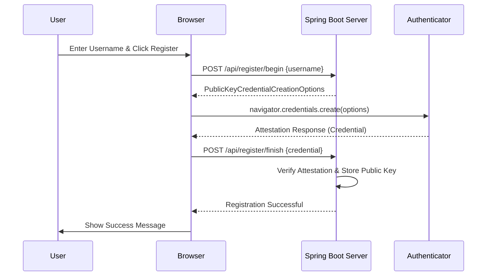
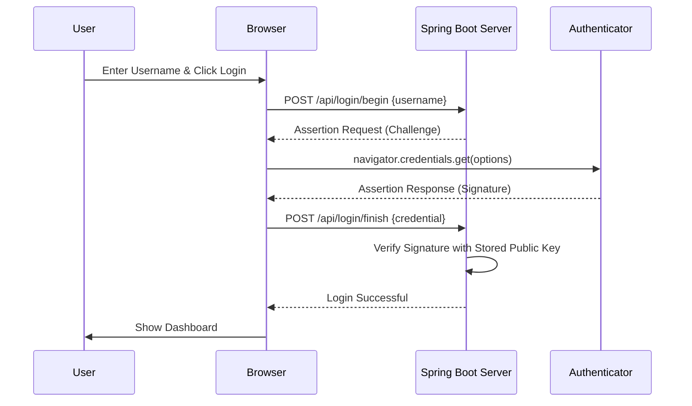

# FIDO2/WebAuthn Demonstration Guide

This project demonstrates the passwordless authentication flow using FIDO2/WebAuthn.

## Architecture Overview

The system consists of three main components:
1. **Authenticator**: The user's device (e.g., TouchID, FaceID, Windows Hello, or a YubiKey).
2. **Client (Browser)**: The web browser that provides the WebAuthn API (`navigator.credentials`).
3. **Relying Party (Server)**: The Spring Boot backend that verifies credentials and manages users.

## Registration Flow



## Authentication Flow



## How to Run the Demo

### 1. Start the Backend
```bash
cd backend
./mvnw spring-boot:run
```
The backend will start on `http://localhost:8080`.

### 2. Start the Frontend
```bash
cd frontend
npm run dev
```
The frontend will start on `http://localhost:5173`.

### 3. Perform the Demo
1. Open `http://localhost:5173` in your browser.
2. Go to the **Register** tab.
3. Enter a username and click **Register Device**.
4. Your browser will prompt you to use your biometric or security key.
5. Once registered, go to the **Sign In** tab.
6. Enter the same username and click **Sign In with FIDO**.
7. Authenticate again with your device.
8. You should see the "Welcome" dashboard!

> [!IMPORTANT]
> WebAuthn requires a secure context (HTTPS or localhost). This demo works on `localhost`.
